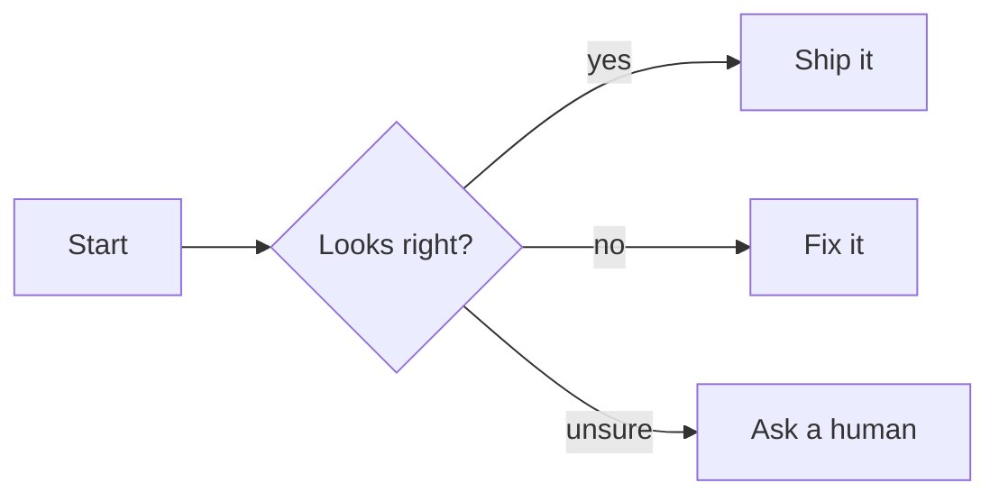
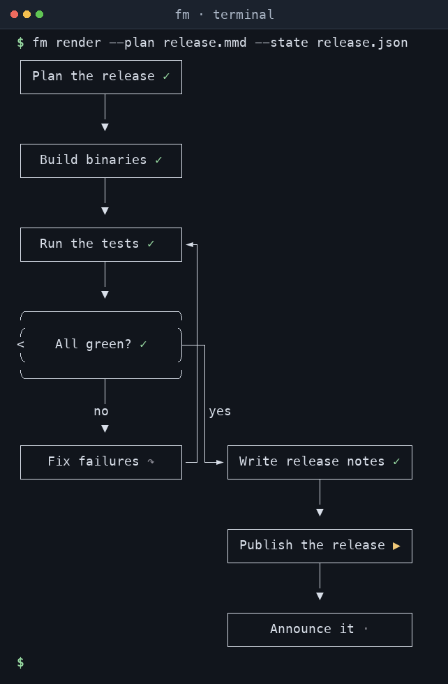

# fm

fm draws a [Mermaid](https://mermaid.js.org/) flowchart with the status of
each node: done, active, failed and so on. You give it the chart and a small
JSON state; it prints plain text for a terminal or a standalone SVG for a
browser. fm runs nothing and keeps nothing between calls, so any tool that
tracks progress through a flowchart can call it to draw that progress.



```console
$ fm render --plan branch.mmd --state state.json
┌─────────┐     ╭────────────────╮        ┌───────────────┐
│         │     ╭                ╮  yes   │               │
│ Start ✓ ├────►< Looks right? ✓ ├────┬──►│   Ship it ▶   │
│         │     ╰                ╯    │   │               │
└─────────┘     ╰────────┬───────╯    │   └───────────────┘
                         │   no       │
                         └────────────┤
                                      │
                                      │   ┌───────────────┐
                                unsure├──►│    Fix it ↷   │
                                      │   └───────────────┘
                                      │
                                      │   ┌───────────────┐
                                      └──►│ Ask a human · │
                                          └───────────────┘
```

`--format svg` draws the same flowchart with each node filled in its status
colour and the arrows taken highlighted, in a dark or light theme.

## Screenshots

A release pipeline, mid-run, in the terminal:



The same plan and state with `--format svg`:

<picture>
  <source media="(prefers-color-scheme: dark)" srcset="assets/screenshots/release-dark.svg">
  
</picture>

The chart and state are in [`assets/screenshots`](assets/screenshots).

## Install

With Rust 1.95 or later:

```sh
cargo install --locked --git https://github.com/lucas-stanford/fm   # installs the `fm` binary
```

When a [GitHub release](https://github.com/lucas-stanford/fm/releases) is
published, the install scripts download its prebuilt binary for Linux (x86_64),
macOS (Apple silicon and Intel) or Windows (x86_64) and add it to `PATH`:

```sh
curl -fsSL https://raw.githubusercontent.com/lucas-stanford/fm/main/install.sh | sh        # macOS, Linux
irm https://raw.githubusercontent.com/lucas-stanford/fm/main/install.ps1 | iex             # Windows
```

## Usage

```
fm render --plan <file|-> [--state <file|->] [--format text|svg] [--theme dark|light] [--out <file>]
```

| Option | Meaning |
|---|---|
| `--plan` | Mermaid flowchart to draw; `-` reads stdin. Required. |
| `--state` | Node statuses and arrows taken (JSON); `-` reads stdin. Optional. |
| `--format` | `text` (default): box-drawing text with no escape codes. `svg`: a standalone, sanitised SVG. |
| `--theme` | `dark` (default) or `light`. Applies to SVG. |
| `--out` | Write to a file instead of stdout. |

Only one of `--plan` and `--state` can read stdin. In SVG output every node
group carries `data-id="<nodeId>"`, so a page can find a node by its id.

## State

```json
{
  "nodes": {"start": "done", "check": "done", "ship": "active", "fix": "skipped"},
  "taken": [["start", "check"], ["check", "ship"]]
}
```

- `nodes` maps a node id to a status. A node that is not listed is `pending`.
- `taken` lists arrows, as `[from, to]` pairs, to highlight.

Both fields are optional, and fm ignores unknown fields. A node id, status or
arrow that the flowchart does not have is an error.

| Status | Glyph |
|---|---|
| `pending` | `·` |
| `active` | `▶` |
| `waiting` | `⏸` |
| `done` | `✓` |
| `failed` | `✗` |
| `skipped` | `↷` |
| `interrupted` | `‼` |

## Supported Mermaid

A flowchart subset: `flowchart`/`graph` with a direction, the common node
shapes, eight arrow types, arrow labels, chains, subgraphs, cycles and `%%`
comments. fm rejects styling directives (`classDef`, `class`, `style`,
`linkStyle`, `click`) because it uses them to draw statuses, and reports
anything else it does not support with its `line:col`.
[docs/SUPPORTED_MERMAID.md](docs/SUPPORTED_MERMAID.md) has the details.

## Exit codes

| Code | Meaning |
|---|---|
| `0` | Success. |
| `1` | Reading, writing or rendering failed. |
| `2` | Bad arguments, flowchart or state. Retrying with the same input fails the same way. |

stdout carries only the rendering; errors go to stderr as `fm: <message>`.

## License

MIT; see [LICENSE](LICENSE). [merman](https://github.com/Latias94/merman) does the rendering.

Contributions are welcome; see [CONTRIBUTING.md](CONTRIBUTING.md).

## Thanks

Thanks to [ferricket](https://github.com/prabirshrestha/ferricket).
